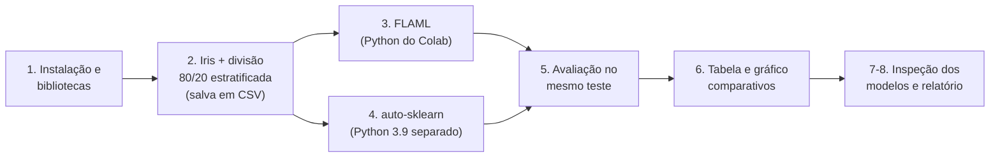
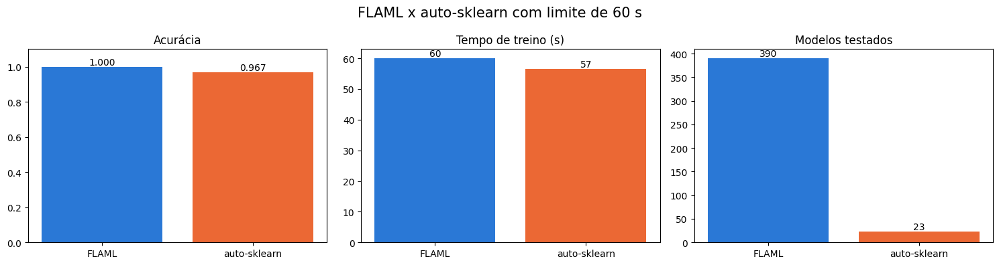
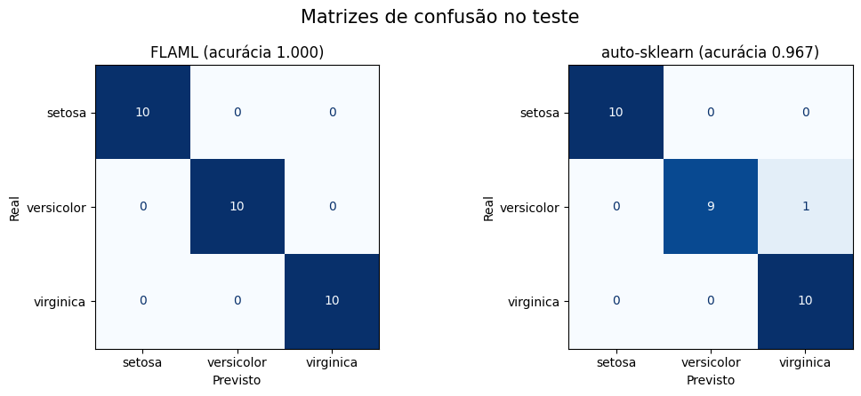

# AutoML: FLAML x auto-sklearn no Iris

Comparação de duas ferramentas de **AutoML**, o **FLAML** e o **auto-sklearn**, no dataset Iris, com a mesma divisão
treino/teste e o **mesmo limite de tempo de busca (60 s)**. A comparação cobre desempenho no teste, tempo de execução,
quantidade de modelos testados e facilidade de inspecionar o modelo final.

Todo o código está num único notebook: [`automl_flaml_autosklearn_iris.ipynb`](automl_flaml_autosklearn_iris.ipynb).

[](https://colab.research.google.com/github/Gabriel-SZ-Silva/automl-flaml-autosklearn-iris/blob/main/automl_flaml_autosklearn_iris.ipynb)

## Sumário

- [Dataset](#dataset)
- [Como o código funciona](#como-o-código-funciona)
- [Como executar](#como-executar)
- [Resultados](#resultados)
- [Relatório](#relatório)
- [Prints](#prints)
- [Estrutura do repositório](#estrutura-do-repositório)

## Dataset

| Dataset | Fonte | Linhas | Atributos | O que o modelo prevê | Classes |
|---|---|:---:|:---:|---|:---:|
| Iris | [scikit-learn](https://scikit-learn.org/stable/modules/generated/sklearn.datasets.load_iris.html) (`load_iris`) | 150 | 4 | espécie da flor | 3 |

A divisão é **80/20 estratificada** com `random_state=42`: 120 flores no treino e 30 no teste, 10 de cada espécie.

## Como o código funciona

O notebook segue esta ordem:



| Seção | O que faz |
|---|---|
| 1. Instalação e bibliotecas | instala o FLAML com `pip` e cria, com o `micromamba`, um ambiente Python 3.9 só para o auto-sklearn |
| 2. Dados | carrega o Iris, faz a divisão **80/20 estratificada** e salva treino e teste em CSV |
| 3. FLAML | treina com `time_budget=60` e guarda em log todas as configurações testadas |
| 4. auto-sklearn | um script separado lê os mesmos CSVs, treina com `time_left_for_this_task=60` e salva previsões e resultados |
| 5. Avaliação | acurácia, `classification_report` e matriz de confusão dos dois modelos no mesmo conjunto de teste |
| 6. Comparação | tabela e gráfico com acurácia, tempo de treino e quantidade de modelos testados |
| 7. Inspeção | o modelo único do FLAML e os modelos do ensemble do auto-sklearn |
| 8. Relatório | texto montado com os números da execução |

O núcleo do código são estas duas chamadas, com o mesmo limite de tempo:

```python
TEMPO = 60  # limite de tempo de busca, em segundos, igual para as duas ferramentas

# FLAML (no notebook)
modelo_flaml = AutoML()
modelo_flaml.fit(X_train, y_train, task="classification", metric="accuracy", time_budget=TEMPO,
                 n_jobs=1, seed=42, log_file_name="resultados/flaml.log", log_type="all", verbose=0)

# auto-sklearn (no script rodar_autosklearn.py, executado pelo Python 3.9)
modelo = AutoSklearnClassifier(time_left_for_this_task=TEMPO, n_jobs=1, seed=42)
modelo.fit(X_train, y_train)
```

Detalhes:

- **Por que dois ambientes Python:** a última versão do auto-sklearn (0.15.0) depende de bibliotecas antigas e não instala no Python 3.12 do Colab. Por isso ele roda num ambiente separado com Python 3.9, e os dois lados trocam dados por arquivos CSV na pasta `resultados/`.
- **Comparação justa:** as duas ferramentas recebem a mesma divisão treino/teste, o mesmo limite de tempo, um único núcleo de CPU (`n_jobs=1`) e a mesma semente (`seed=42`).
- **Validação interna:** cada ferramenta usa a sua validação padrão para escolher os modelos durante a busca. O conjunto de teste só é usado na avaliação final.

## Como executar

O notebook foi feito para o **Google Colab**, porque cria o ambiente do auto-sklearn na pasta `/content`.

1. Clique no botão **Open in Colab** acima.
2. Menu *Ambiente de execução → Executar tudo*.
3. Espere uns 8 minutos: de 3 a 5 na instalação do auto-sklearn e 1 minuto de busca para cada ferramenta.

Os resultados aparecem no próprio notebook e são salvos na pasta `resultados/` do Colab. O arquivo
[`requirements.txt`](requirements.txt) lista as bibliotecas usadas pelo notebook; o auto-sklearn não está nele porque é
instalado pelo próprio notebook no ambiente separado.

## Resultados

Medidos no conjunto de **teste** (30 flores, separadas antes do treino). Em negrito, o melhor valor.

| Ferramenta | Acurácia | Tempo de treino (s) | Modelos testados | Modelo final |
|---|:---:|:---:|:---:|---|
| FLAML | **1.000** | 60.0 | **390** | 1 modelo (`lrl1`, regressão logística com regularização L1) |
| auto-sklearn | 0.967 | **56.6** | 23 | ensemble de 20 modelos |

<p align="center"></p>

### Métricas por espécie

| Ferramenta | Espécie | Precisão | Recall | F1 |
|---|---|:---:|:---:|:---:|
| FLAML | setosa | 1.000 | 1.000 | 1.000 |
| FLAML | versicolor | 1.000 | 1.000 | 1.000 |
| FLAML | virginica | 1.000 | 1.000 | 1.000 |
| auto-sklearn | setosa | 1.000 | 1.000 | 1.000 |
| auto-sklearn | versicolor | 1.000 | 0.900 | 0.947 |
| auto-sklearn | virginica | 0.909 | 1.000 | 0.952 |

O FLAML acertou as 30 flores. O auto-sklearn errou uma: classificou uma *versicolor* como *virginica*.

### Busca do auto-sklearn

Resumo impresso pelo próprio auto-sklearn (`sprint_statistics`):

| Pipelines testados | Com sucesso | Com falha | Passaram do limite de tempo | Passaram do limite de memória | Melhor acurácia de validação |
|:---:|:---:|:---:|:---:|:---:|:---:|
| 23 | 22 | 0 | 1 | 0 | 0.975 |

Os 20 modelos do ensemble final, agrupados por algoritmo:

| Algoritmo | Modelos | Peso somado no ensemble |
|---|:---:|:---:|
| random_forest | 7 | 0.36 |
| passive_aggressive | 2 | 0.16 |
| mlp | 2 | 0.14 |
| gradient_boosting | 3 | 0.10 |
| extra_trees | 2 | 0.10 |
| libsvm_svc | 1 | 0.06 |
| liblinear_svc | 1 | 0.04 |
| adaboost | 1 | 0.02 |
| decision_tree | 1 | 0.02 |

Os números estão em [`resultados/comparacao.csv`](resultados/comparacao.csv) e
[`resultados/leaderboard_autosklearn.csv`](resultados/leaderboard_autosklearn.csv).

## Relatório

**1. Desempenho.** Com a mesma divisão treino/teste e o mesmo limite de 60 s, o FLAML teve a melhor acurácia no teste
(1.000 contra 0.967 do auto-sklearn). A diferença é de **uma flor**: o teste tem só 30 exemplos, então cada erro vale
3.3 pontos percentuais. Isso não basta para dizer que uma ferramenta é melhor que a outra. O Iris é um problema fácil e
as duas chegam perto do máximo possível.

**2. Custo computacional.** O treino levou 60.0 s no FLAML e 56.6 s no auto-sklearn: as duas usam praticamente todo o
tempo que recebem. A diferença está no que cabe nesse tempo. O FLAML testou **390 configurações** e o auto-sklearn,
**23 pipelines**, cerca de 17 vezes menos. O FLAML começa pelos modelos mais baratos e roda tudo no mesmo processo. O
auto-sklearn roda cada pipeline em um processo separado, com limite de tempo e de memória, e ainda monta um ensemble no
final. Além disso, o auto-sklearn não instala no Python atual do Colab e precisou de um ambiente separado com Python
3.9, o que deixou a instalação bem mais demorada que a do FLAML.

**3. Interpretabilidade / Pipelines.** O FLAML foi o mais fácil de inspecionar: ele devolve **um único modelo**
(`lrl1`, uma regressão logística) e os hiperparâmetros ficam em `best_config`. O auto-sklearn devolve um **ensemble de
20 modelos** de 9 algoritmos diferentes, cada um com seu peso e seu pré-processamento. O `leaderboard()` ajuda a ver
esses modelos, mas entender a decisão final exige olhar vários deles ao mesmo tempo.

## Prints

### Matrizes de confusão

<p align="center"></p>

As saídas completas, com todas as tabelas, aparecem abrindo o [notebook](automl_flaml_autosklearn_iris.ipynb) aqui no GitHub.

## Estrutura do repositório

```
automl-flaml-autosklearn-iris/
├── automl_flaml_autosklearn_iris.ipynb   # todo o código (com as saídas da última execução)
├── requirements.txt                      # bibliotecas usadas pelo notebook
├── resultados/
│   ├── comparacao.csv                    # acurácia, tempo de treino e modelos testados
│   ├── leaderboard_autosklearn.csv       # os 20 modelos do ensemble do auto-sklearn
│   └── figuras/                          # matrizes de confusão e gráfico comparativo
├── LICENSE
└── README.md
```

## Licença

[MIT](LICENSE).
